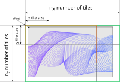

`TiledImage` splits a NumPy image into a grid of tiles that you can process
individually and merge back into an image.



## Example: extract the red channel

```python
import numpy as np
from slice_merge.slice_merge import TiledImage

image = np.arange(8 * 8 * 3).reshape(8, 8, 3)  # rows, columns, RGB
tiled = TiledImage(image, tile_size=4, overlay=1)

def get_red_channel(tile):
    return tile[:, :, 0]

red_tiles = tiled.apply(get_red_channel)
red = tiled.merge(red_tiles)  # 2-D, equal to image[:, :, 0]
```

`list_tiles()` gives you the tiles in row-major order for manual processing.
`apply()` returns one result per tile and leaves the stored tiles unchanged,
even if the callback modifies its input.

## Grid and padding

Supply `tile_size` (the core size, excluding the halo) or `number_of_tiles`.
An integer applies to both spatial axes; pairs are in `(rows, columns)` order.
`offset=(1, 2)` places the first image pixel at row 1, column 2 of the tile
grid. By default, `keep_rest=True` retains the whole image, including partial
edge tiles. With `keep_rest=False`, trailing pixels outside the grid are
dropped. `image()` reconstructs only the retained input region.

`overlay` adds a halo of that many pixels on each side of every core. Halos
use neighboring pixels where available. When an offset or halo is present,
padding beyond the image uses symmetric reflection (the edge pixel repeats).
With neither an offset nor a halo, unused cells in partial tiles stay zero.
Padding affects only the spatial axes, not channels.

## Merging and replacing tiles

- `merge(results)` defaults to `tile_layout="auto"`. With a halo, it strips
  the halo from results of the original full-tile size and accepts results
  of the original core size unchanged. It rejects other spatial sizes rather
  than guessing. Without a halo, results are already cores and may be resized.
- For resized cores with a halo, use `merge(results, tile_layout="core")`.
  If you resized whole tiles, trim the halo in **output pixel coordinates**
  before merging. Explicit core mode never strips a halo, even if the
  resized core happens to match the original full-tile size.
- `set_tile(i, j, data)` replaces one full tile or just its core. A core
  replacement leaves that tile's halo intact. Single-channel replacements
  can be 2-D; an incompatible shape returns `False`. Neighboring halos are
  not refreshed. Before another operation that uses neighborhoods, build a
  new `TiledImage` from `tiled.image()` to recompute the halos.
